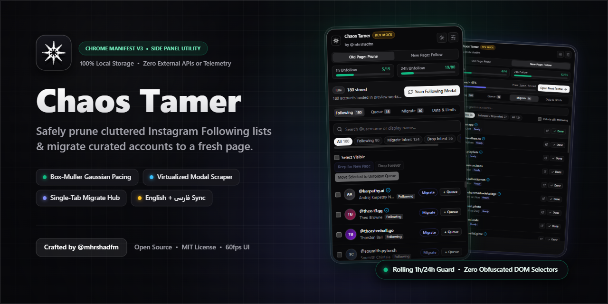
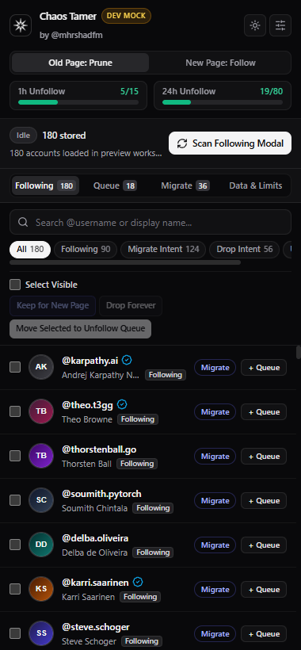
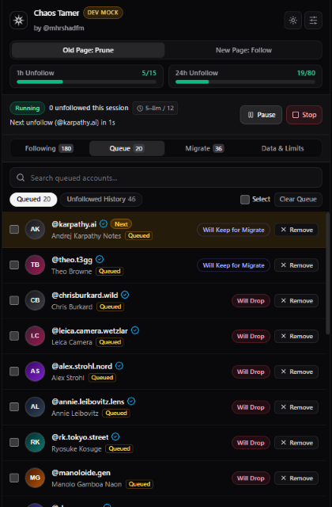
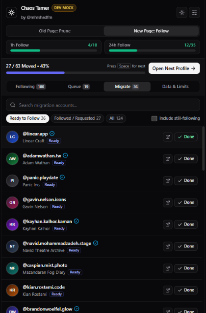
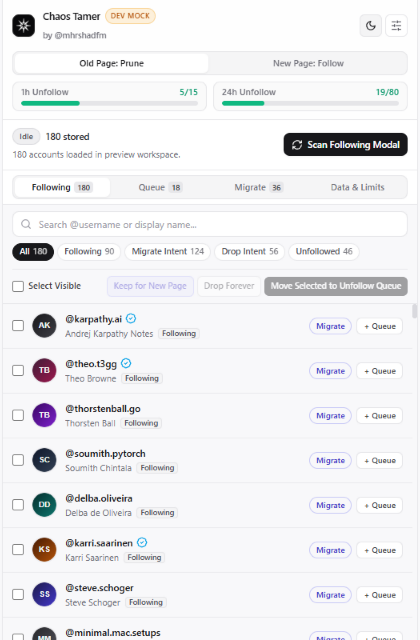

<div align="center">



<br />

# Chaos Tamer

**Safely declutter bloated Instagram Following lists & migrate curated accounts to a fresh page — without rate-limit bans or tab overload.**

[](#quick-installation)
[](#android-app-samsung-galaxy-s20-fe-5g--android-13--one-ui-51)
[](#development--scripts)
[](#privacy--security)
[](#core-features)
[](LICENSE)
[](https://www.instagram.com/mhrshadfm/)

[**Install Chrome Extension**](#quick-installation) · [**Install Android APK**](#android-app-samsung-galaxy-s20-fe-5g--android-13--one-ui-51) · [**Screenshots**](#side-panel-interface) · [**Old → New Page Guide**](#cross-profile-migration-workflow) · [**Anti-Ban Safety**](#anti-ban-engineering) · [**Changelog**](CHANGELOG.md) · [**Build from Source**](#development--scripts)

</div>

---

## Why Chaos Tamer?

Starting a clean Instagram page—or decluttering years of accumulated accounts on an old one—usually hits three frustrating walls:

1. **Virtualized Modals Lose Accounts:** Instagram unmounts upper DOM rows as you scroll down long Following modals, breaking naive copy-paste scripts.
2. **Aggressive Rate Limits Trigger Action Blocks:** Rapid unfollowing or mass-following on a brand-new account triggers `"Try Again Later"` restrictions within minutes.
3. **100-Tab Chaos During Migration:** Moving curated creators to a new account manually means drowning in hundreds of browser tabs with zero progress tracking.

**Chaos Tamer** docks natively in Chrome's persistent **Side Panel** (`360px–440px`) with a crisp macOS Sonoma/Sequoia aesthetic, harvesting virtualized modals tick-by-tick, enforcing rolling `1h` / `24h` rate limits with Box-Muller Gaussian delays, and stepping through curated profiles inside a **single reusable Instagram tab**.

---

## Side Panel Interface

<table>
  <tr>
    <th align="center" width="25%">Following & Bulk Triage</th>
    <th align="center" width="25%">Gaussian Safe Queue</th>
    <th align="center" width="25%">Single-Tab Migrate Hub</th>
    <th align="center" width="25%">macOS Light Theme</th>
  </tr>
  <tr>
    <td align="center"></td>
    <td align="center"></td>
    <td align="center"></td>
    <td align="center"></td>
  </tr>
</table>

---

## Core Features

- **⚡ Virtualized-DOM-Safe Modal Scraper**
  - Dynamically locates Instagram's active `div[role="dialog"]` scroll container via computed layout styles—**zero brittle obfuscated CSS class selectors** (immune to `_aacl` / `x1lliihq` hashed class rotations).
  - Harvests mounted rows on every scroll step + `MutationObserver`, scrolling at humanized `65%–90%` viewport increments with `4–7s` reading pauses every 15 steps so GraphQL pagination never hits HTTP `429`.
- **🎯 Triage Intents (`Migrate` vs `Drop`) & 60fps Virtual List**
  - Smoothly browse and filter **3,000+ accounts at 60fps** using a custom windowed virtual scroller.
  - Decide per account—or in bulk—whether to **Keep for New Page (`Migrate`)** or **Drop Forever (`Drop`)**.
- **🔄 Dual-Mode Unfollow Engine (Passive Sync + Humanized Runner)**
  - **Mode A — Always-On Passive Tracker:** Prefer clicking manually? Chaos Tamer silently detects your manual `Unfollow` confirmations and `Follow` clicks in real time and updates your progress & rolling gauges automatically.
  - **Mode B — Opt-In Safe Auto-Unfollow:** Dispatches realistic pointer sequences, waits truncated **Box-Muller Gaussian delays (`28s–58s`)** with live 1-second countdowns, takes **`5–8 min` micro-breaks** every 12 actions, and halts instantly via an **Emergency Circuit Breaker** if any restriction banner appears.
- **🧭 Single-Tab Hyperlink Migration Hub**
  - Built specifically for warming up your **new Instagram account**: click any `@username` or press **`Space` (`Open Next Profile →`)** to navigate your single active Instagram tab cleanly from one curated account to the next—zero tab explosion.
- **🌐 Native Bilingual Detection (`English` + `فارسی`)**
  - Full normalized label & restriction-banner matching across both **English** and **Persian** (`دنبال می‌کنید`, `درخواست شده`, `لغو دنبال کردن`, `دنبال کردن`) Instagram UI locales, including Arabic/Persian `ی`/`ک` and ZWNJ normalization.
- **📦 Cross-Profile JSON Backup & RFC 4180 CSV Export**
  - Export your complete state (`chaos-tamer-backup.json`) from Chrome Profile A (old account) and import it (`Merge` or `Replace`) into Chrome Profile B (new account) with strict runtime schema validation.

---

## Quick Installation

### Option A: Download Ready-to-Use Release *(Recommended — No Coding Needed)*

1. Go to the [**Releases**](../../releases) section of this repository and download **`chaos-tamer.zip`**.
2. Extract `chaos-tamer.zip` to a permanent folder on your computer.
3. Open Google Chrome and navigate to `chrome://extensions`.
4. Toggle **Developer mode** ON in the top-right corner.
5. Click **Load unpacked** and select the extracted folder (the folder containing `manifest.json`).
6. Pin **Chaos Tamer** in your Chrome toolbar and click its icon while on [instagram.com](https://www.instagram.com/) to dock the Side Panel!

### Option B: Build from Source *(Developers)*

> Requires **Node.js 18+** (100% cross-platform on Windows 11, macOS, and Linux—zero native binary dependencies).

```bash
git clone https://github.com/mhrshadfm/chaos-tamer.git
cd chaos-tamer
npm install
npm run build
```

Then open `chrome://extensions` → enable **Developer mode** → click **Load unpacked** → select the generated **`dist/`** directory.

---

## Android App (Samsung Galaxy S20 FE 5G · Android 13 / One UI 5.1)

**Chaos Tamer** also ships as a standalone, self-contained **native Android application** (`release/chaos-tamer-android.apk`, package `com.mhrshadfm.chaostamer`, `minSdk 26` / `targetSdk 34`, signed with APK Signature Scheme v2 + v3 for Android 13 / One UI 5.1).

Because mobile browsers cannot run Chrome Side Panel extensions directly against the native Instagram app, the Chaos Tamer Android app embeds a **dual-surface native workspace** (`Chaos Tamer` · `Split View` · `Instagram`) with origin-isolated `WebMessageListener` bridging—requiring **only `INTERNET` permission** (zero Accessibility Service or Android 13 "Restricted Setting" blocks).

### Installing on Samsung Galaxy S20 FE 5G (One UI 5.1)

1. Download **`chaos-tamer-android.apk`** from [**Releases**](../../releases) directly on your phone — or transfer **`release/chaos-tamer-android.apk`** from your PC via **Samsung Quick Share**, USB cable, Telegram Saved Messages, or Google Drive.
2. Open Samsung **My Files** → **Downloads** (or wherever you saved it) and tap **`chaos-tamer-android.apk`**.
3. If One UI 5.1 prompts *"For your security, your phone currently isn't allowed to install unknown apps from this source"*:
   - Tap **Settings** → toggle **Allow from this source** ON for **My Files** → tap **Install**.
4. If Google Play Protect shows *"Unrecognized app developer"* (normal for self-signed personal APKs), tap **More details** → **Install anyway**.
5. Launch **Chaos Tamer** from your One UI home screen / app drawer (includes Adaptive + Android 13 Monochrome themed icon support).

### Using Chaos Tamer on Android

1. **Sign In & Open Your Following List:**
   - Tap **`Instagram`** (or **`Split View`**) in the top workspace bar and sign into your Instagram account.
   - Open your profile and tap **Following** so your `/<username>/following/` list (or modal in `Desktop Instagram Layout`) is visible.
2. **Scan, Triage & Prune:**
   - Switch to **`Split View`** (drag the center handle to resize panes; double-tap to reset) and tap **`Scan`** in Chaos Tamer. The screen stays awake automatically while scanning or auto-unfollowing.
   - Mark accounts as **`Migrate`** or **`Drop`**, then unfollow manually (tracked passively) or run **`Start Safe Auto-Unfollow`** from the **Queue** tab.
3. **Migrate to Your New Page (or Sync with PC):**
   - Tap **`⋮`** in the top-right bar → **`Switch IG Account (Clear IG Login)`** to sign out of Instagram *without* losing any Chaos Tamer extracted accounts, intents, or rate-limit gauges, then sign into your **New Page** and use the **`Migrate`** tab (`Open Next Profile →`).
   - Or open **`Data & Limits`** → **`Share Backup via Quick Share / Apps`** to beam `chaos-tamer-backup.json` straight between your Galaxy S20 FE 5G and your PC Chrome Extension!

---

## Cross-Profile Migration Workflow

> [!TIP]
> For maximum account hygiene, log into your **Old Instagram Page** and **New Instagram Page** in **two separate Chrome Profiles** and transfer state via JSON Backup.

1. **Scan & Triage (Chrome Profile 1 — Old Account):**
   - Switch Chaos Tamer to **`Old Page: Prune`**.
   - Open your Instagram profile → click **Following** so the modal opens → click **`Scan Following Modal`**.
   - Filter/search your list: mark accounts worth keeping as **`Migrate`** and clutter accounts as **`Drop`**.
2. **Prune Safely (Optional):**
   - Unfollow manually (tracked automatically) or move items to the **Queue** tab and run **`Start Safe Auto-Unfollow`**.
3. **Transfer State to Your New Profile:**
   - Open **`Data & Limits`** → click **`Export JSON Backup`** (`chaos-tamer-backup.json`).
   - In Chrome Profile 2 (logged into your new Instagram account), open **`Data & Limits`** → **Import JSON Backup** (`Replace` or `Merge`).
4. **Follow Curated Accounts at Warmup Speed:**
   - Switch the top mode pill to **`New Page: Follow`** (`10/hour`, `35/day` warmup preset).
   - Open the **`Migrate`** tab and press **`Space`** (or click **`Open Next Profile →`**) to step through your curated list in a single tab. When you click **Follow** on Instagram, Chaos Tamer automatically marks the account `Followed` / `Requested` and logs a warmup timestamp!

---

## Anti-Ban Engineering

| Safety Parameter | `Old Page: Prune` Preset | `New Page: Follow` Preset | Configurable? |
| :--- | :---: | :---: | :---: |
| **Rolling 1-Hour Cap** | `15 / hour` | `10 / hour` | Yes (`Data & Limits`) |
| **Rolling 24-Hour Cap** | `80 / 24h` | `35 / 24h` | Yes (`Data & Limits`) |
| **Inter-Action Pacing** | `28s – 58s` (Box-Muller Gaussian) | Passive / Manual Single-Tab | Yes (`min` / `max` sliders) |
| **Session Micro-Break** | `5 – 8 min` every `12` actions | — | Yes (`batch` & duration) |
| **Emergency Circuit Breaker** | Auto-halts on EN/FA restriction alerts | Warnings at `70%` (`amber`) & `100%` (`rose`) | Always Active |

- **Serialized Background Storage Mutex:** All `chrome.storage.local` writes route through an exclusive Promise lock in `src/background/store.ts`, eliminating lost-update race conditions during rapid scroll harvesting.
- **Exact Rolling Cooldown Math:** Timestamps are pruned strictly over a `86,400,000 ms` sliding window—never naive midnight resets—computing exact `MM:SS` slot recovery times.

---

## Privacy & Security

- **100% Local Execution:** Every account record, intent tag, and rate-limit timestamp stays strictly inside your browser's local `chrome.storage.local`.
- **Zero Credentials or Private APIs:** Chaos Tamer **never** reads cookies, session tokens, or passwords, and makes **zero** network requests to external servers or analytics endpoints.
- **Minimal MV3 Permissions:** Requests only `storage`, `sidePanel`, `tabs`, `alarms`, and host access scoped exclusively to `https://www.instagram.com/*`.

---

## Development & Scripts

Want to test or customize the Side Panel UI without even logging into Instagram? Run Vite in **Standalone Mock-Bridge Mode**—pre-seeded with **180 offline-ready mock accounts** and simulated scraper/Gaussian timers:

```bash
npm run dev           # Launch interactive Side Panel preview at http://localhost:5173
npm run typecheck     # Run strict TypeScript compiler checks (tsc --noEmit)
npm test              # Run Node TypeScript unit tests (mobile/desktop DOM selectors & native bridges)
npm run build         # Clean, generate PNG icons, compile MV3 targets, and verify dist/
npm run verify        # Validate dist/manifest.json, PNG headers, and standalone IIFE content.js
npm run package       # Production build + create release/chaos-tamer.zip & chaos-tamer-v1.1.0.zip
npm run build:android # Build web bundle + run Kotlin JUnit tests + assemble release/chaos-tamer-android.apk & v1.1.0 mirror (requires JDK 17 + Android SDK; auto-generates signing keystore if absent)
```

<details>
<summary><strong>Repository Structure</strong></summary>

```text
chaos-tamer/
├── android/                       # Native Kotlin Android app (Dual-WebView Split Workspace, minSdk 26 / targetSdk 34)
│   └── app/src/
│       ├── main/java/...          # MainActivity, ChaosTamerStateStore (atomic mutex), InstagramUrlPolicy
│       └── test/java/...          # JUnit 4 JVM unit tests for state store & URL/deep-link policy
├── assets/
│   └── chaos-tamer-source.png     # High-res RGBA emblem source for pure-Node icon generators
├── docs/images/                   # Social preview banner (1280x640) & Side Panel UI screenshots
├── public/
│   ├── icons/                     # Generated pure-white emblem & 16/32/48/128 squircle icons
│   └── manifest.json              # Chrome Manifest V3 configuration
├── scripts/
│   ├── build-android-apk.mjs      # End-to-end Android icon, asset sync, JUnit test & signed APK builder
│   ├── clean.mjs                  # Cross-platform dist/ cleaner
│   ├── generate-android-icons.mjs # Adaptive + Android 13 Monochrome + legacy mipmap icon generator
│   ├── generate-icons.mjs         # Zero-dependency Node zlib/CRC32 PNG icon generator
│   ├── sync-android-assets.mjs    # Copies compiled sidepanel + content.js into Android app assets
│   ├── verify-dist.mjs            # MV3 bundle & IIFE integrity verifier
│   └── zip-dist.mjs               # Pure-Node PKZIP/DEFLATE release packager
├── src/
│   ├── background/                # Service Worker & StorageMutex atomic state store
│   ├── content/                   # Semantic EN/FA selectors, virtualized scraper, passive/safe engines
│   ├── lib/                       # Rolling rate limiter, Box-Muller math, CSV/JSON exporters, Chrome/Android bridge
│   ├── sidepanel/                 # React 18 + Tailwind macOS Side Panel UI & 60fps virtual list
│   └── types/                     # Strict schema & RPC message contracts
├── tests/                         # Node test runner suite for selectors, bridges, and exporters
├── sidepanel.html
├── vite.sidepanel.config.ts
├── vite.background.config.ts
└── vite.content.config.ts
```

</details>

---

## Disclaimer

Chaos Tamer is an independent, local productivity and browser-accessibility utility created for personal account organization. It is **not** affiliated with, endorsed by, or sponsored by Instagram or Meta Platforms, Inc. Always use automation features responsibly and within platform guidelines; the author assumes no liability for account restrictions resulting from misuse or aggressive custom rate-limit overrides.

---

## License & Credits

Released under the [**MIT License**](LICENSE).

Crafted by [**@mhrshadfm**](https://www.instagram.com/mhrshadfm/) — if **Chaos Tamer** saved you hours of manual cleanup, consider giving this repository a **⭐ Star** on GitHub!
